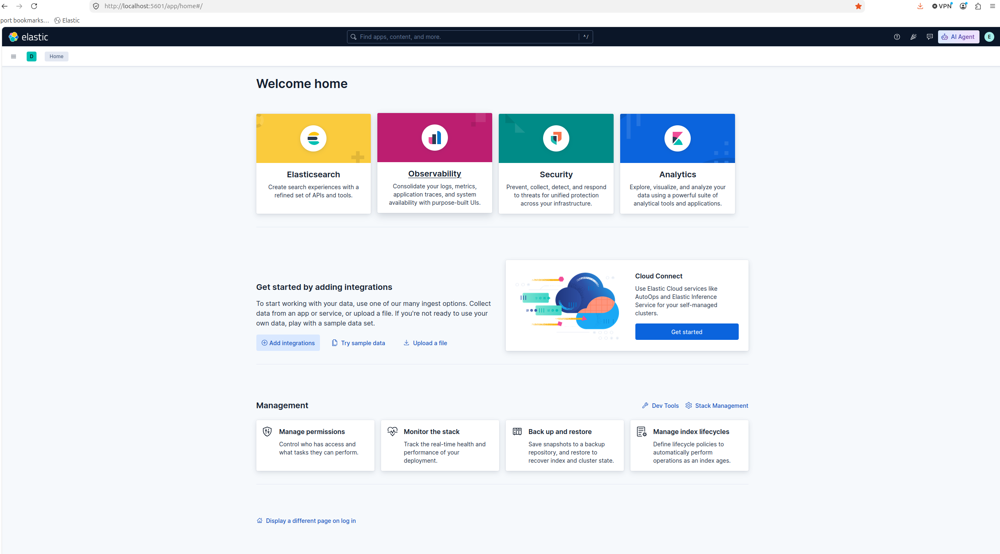

## 1. Requisitos previos

Antes de comenzar, asegúrate de tener instalados los siguientes componentes:

- Docker Engine.
- Docker Compose (plugin de Docker).
- Git, para clonar este repositorio.
- Un terminal para ejecutar los comandos.

Comprueba que Docker está instalado correctamente:

```bash
docker --version
docker compose version
```
Comprueba que Docker está en ejecución:

```bash
docker ps
```


## 2. Descargar el repositorio


Clona el repositorio de GitHub:

```bash
git clone <URL_DEL_REPOSITORIO>
```

Accede al directorio que contiene el archivo docker-compose.yaml:

```bash
cd <DIRECTORIO_DEL_PROYECTO>
```

Comprueba que el archivo compose.yaml está presente:
```bash
ls
```


## 3. Configurar las variables de entorno

Antes de arrancar Elasticsearch, crea un archivo `.env` en el mismo directorio que `compose.yaml`.

Este archivo contiene las variables de entorno utilizadas por Docker Compose.

### 3.1. Crear el archivo `.env`

```bash
nano .env
```

Añade las variables requeridas por tu configuración:

```bash
ELASTIC_PASSWORD=CAMBIA_POR_UNA_CLAVE_SEGURA
KIBANA_PASSWORD=CLAVE_SUPER_SEGURA_KIBANA
KIBANA_ENCRYPTION_KEY=CAMBIARCLAVE
```
Puedes consultar un ejemplo de archivo docker/.env.example

## 4. Arrancar Elasticsearch

Desde el directorio que contiene `compose.yaml`, ejecuta:

```bash
docker compose up -d
```
El parámetro -d permite ejecutar los contenedores en segundo plano.
Comprueba el estado de los servicios:

```bash
docker compose ps
```

Para consultar los registros de Elasticsearch:


```bash
docker compose logs -f elasticsearch
```

## 5. Acceder a Kibana

Una vez que Kibana haya terminado de arrancar, abre:

[http://localhost:5601](http://localhost:5601)

Inicia sesión con las credenciales que hayas configurado en el archivo .env



## 7. Gestionar los servicios

### Detener los contenedores

```bash
docker compose stop
```

Volver a arrancarlos

```bash
docker compose start
```

## 8. Recursos útiles

- [Documentación oficial de Elasticsearch](https://www.elastic.co/guide/en/elasticsearch/reference/current/index.html)
- [Documentación oficial de Docker Compose](https://docs.docker.com/compose/)
