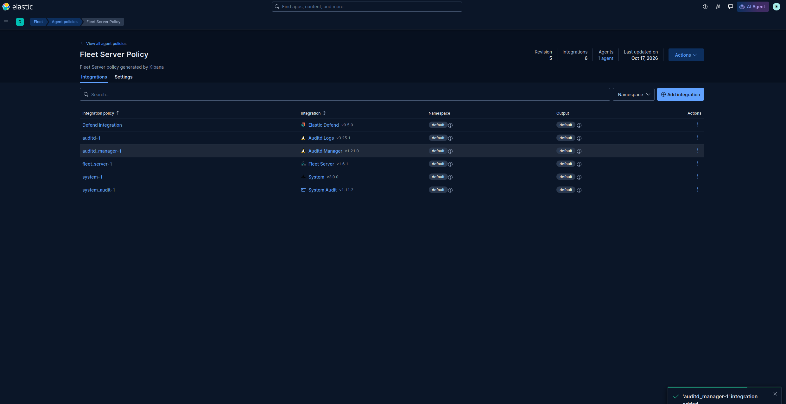

## Elastic configuration

Para mejorar la calidad de los logs es importante añadir las siguientes integraciones:

- Elastic Defend
- Logs auditor
- Audit Manager
- Audit
- System Audit

En el fleet server Policy le damos click a añadir integración, buscamos añadir una por una las integraciones.

