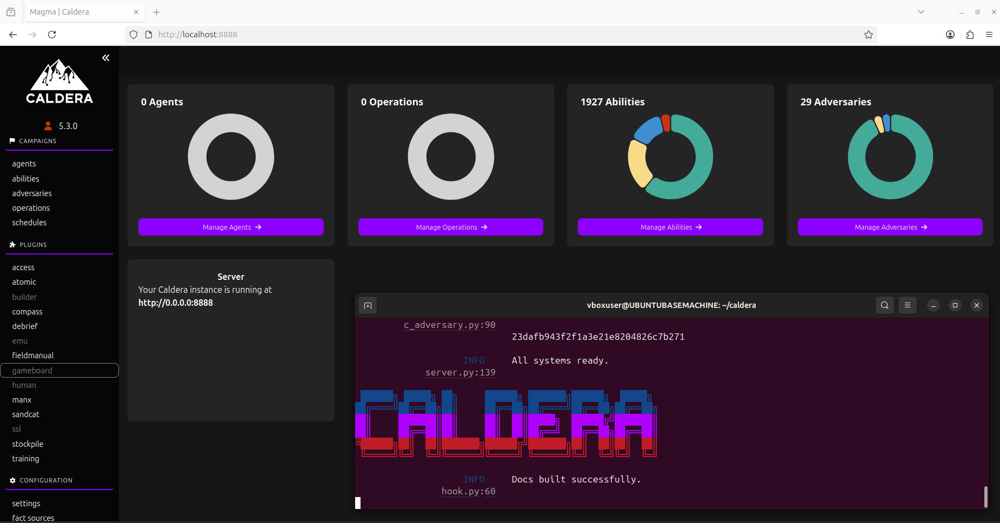

## Instalación de Caldera

### 1. Instalar las dependencias

Ejecuta los siguientes comandos para instalar las dependencias necesarias:

```bash
sudo apt install upx-ucl
sudo apt install nodejs npm
sudo apt install golang-go
sudo apt install curl
sudo apt install python3-pip
sudo apt install python3.14-venv
```
2. Crear y activar un entorno virtual de Python. 
Crea un entorno virtual llamado caldera:

```bash
python3 -m venv caldera
```
Activa el entorno virtual:

```bash
source caldera/bin/activate
```

3. Instalar Docker para Python
Con el entorno virtual activado, ejecuta:
```bash
pip install docker
```

4. Descargar el repositorio de Caldera
Clona el repositorio oficial de Apache Caldera junto con sus submódulos:

```bash
git clone https://github.com/apache/caldera.git --recursive
```

Accede al directorio del proyecto:
```bash
cd caldera
```

5. Instalar los requisitos de Caldera
Instala las dependencias de Python indicadas en el archivo requirements.txt:

```bash
pip install -r requirements.txt
```

6. Arrancar Caldera
```bash
python3 server.py --insecure --build
```

7. Acceder a la interfaz web
Una vez iniciado el servidor, abre el siguiente enlace en tu navegador:
http://localhost:8888



