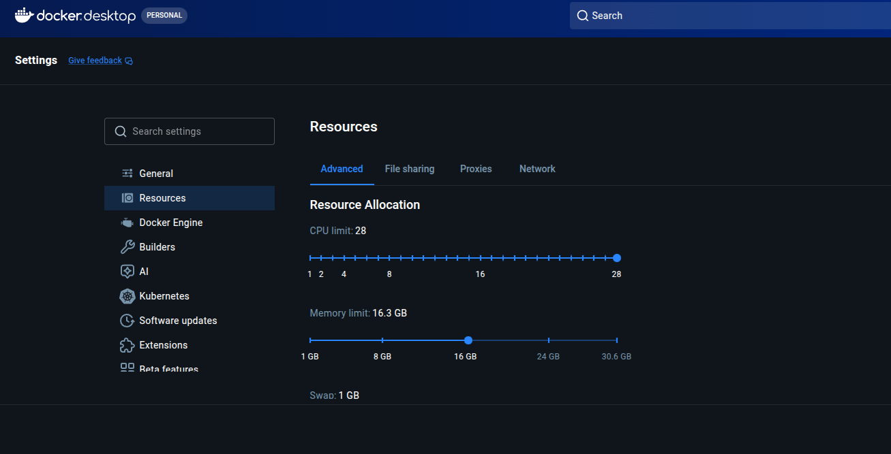
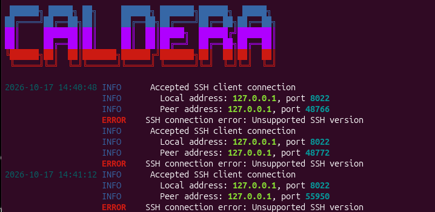

## Ejercicios

Durante la construcción del laboratorio me encontré con algunos obstáculos los señalo a continuación para facilitar su resoluición:

### 1. Fleet Agent Unhealthy
Si al volver a arancar elasticsearch notas que el estado es Unhealthy espera un poco, algunas integraciones toman varios minutos incluso 10 minutos en levantarse correctamente

### 2. Elasticsearch exited (137)
"Container elasticsearch Error dependency elasticsearch failed to start
dependency failed to start: container elasticsearch exited (137)". 
Revisa que Docker dispone de almenos 16gb de ram

### 3. Permisos insuficientes
Al arrancar elastic e introducir la clave te dice que no tienes los permisos necesarios para acceder. Estas usando la clave de kibana en lugar de la de elasticsearch, revisa tu env y compose_docker.yml e introduce la correcta

### 4. Buscador de Elastic no arroja resultados 
Utilizas el buscador de elsatic para llegar a algún menú y no responde, revisa la conexión de internet. 

## 5. Caldera: Unsupported SSH Version

Estas usando el puerto incorrecto para la conexión intenta con http://localhost:8888

