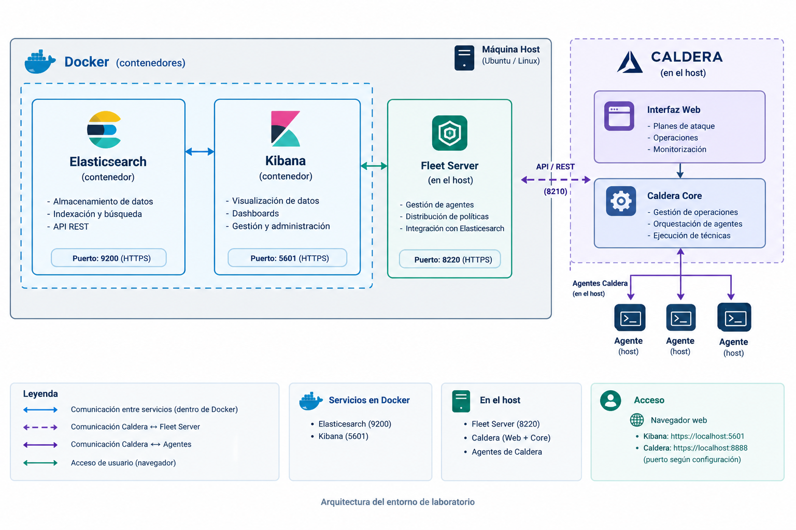

# Cybersecurity Detection & Adversary Emulation Lab

A self-hosted cybersecurity lab combining Elastic Stack and MITRE Caldera
to explore security monitoring, telemetry collection and adversary emulation.

The project provides a reproducible environment for learning how security
events are generated, collected, indexed and analyzed.

## Overview

This lab combines defensive security monitoring with controlled adversary
emulation in a home lab environment.

It brings together:

- **Elasticsearch:** Storage, indexing and search of security data.
- **Kibana:** Dashboards, visualization and investigation of events.
- **Fleet Server:** Centralized management of Elastic Agents.
- **MITRE Caldera:** Adversary emulation and operation orchestration.
- **Agents:** Telemetry collection and controlled execution of emulation
  activities, depending on the agent type.

Elasticsearch and Kibana run in Docker containers, while Fleet Server and
Caldera run directly on the host.

## Architecture



See the [architecture documentation](docs/05-architecture.md) for further
details.

## Objectives

The lab is designed to help users explore:

- Security telemetry collection and analysis.
- Elastic Stack deployment and configuration.
- Elastic Agent and Fleet Server management.
- Adversary emulation with MITRE Caldera.
- The relationship between simulated adversary activity and observable
  security events.
- Detection engineering and investigation workflows.

## Getting Started

Follow the documentation in the recommended order.

| Step | Documentation | Description |
|---|---|---|
| 1 | [Prerequisites](docs/01-prerequisites.md) | Review hardware, software and network requirements. |
| 2 | [Elasticsearch Installation](docs/02-installation-elasticsearch.md) | Start Elasticsearch and Kibana. |
| 3 | [Elasticsearch Configuration](docs/03-elastic-configuration.md) | Configure Elasticsearch |
| 4 | [Caldera Installation](docs/04-installation-caldera.md) | Install and configure Caldera. |
| 5 | [Architecture](docs/05-architecture.md) | Understand the components and their communication. |
| 6 | [Troubleshooting](docs/06-troubleshooting.md) | Diagnose common installation and configuration issues. |


## Repository Structure

```text
.
├── README.md
├── docs/
│   ├── 01-prerequisites.md
│   ├── 02-installation-elasticsearch.md
│   ├── 03-elastic-configuration.md
│   ├── 04-installation-caldera.md
│   ├── 05-architecture.md
│   ├── 06-troubleshooting.md
│   └── images/
├── docker/
├── exercises/
├── presentation/
```

Some directories may be added as the project evolves.

## Requirements

The lab requires a Linux host with sufficient resources to run the services
and agents.

The main dependencies include:

- Docker Engine and Docker Compose.
- Python and the dependencies required by Caldera.
- Go and Node.js/npm where required by the selected Caldera release.
- Network connectivity between the lab components.

Refer to the [prerequisites guide](docs/01-prerequisites.md) for details.

## Security Notice

This project is intended for educational purposes and authorized testing
in controlled environments.

- Only run adversary emulation against systems you own or have explicit
  permission to test.
- Do not expose management interfaces directly to the public Internet.
- Protect passwords, API keys and certificates.
- Never commit real credentials or private keys to the repository.

## Contributing

Suggestions, documentation improvements and bug reports are welcome.


